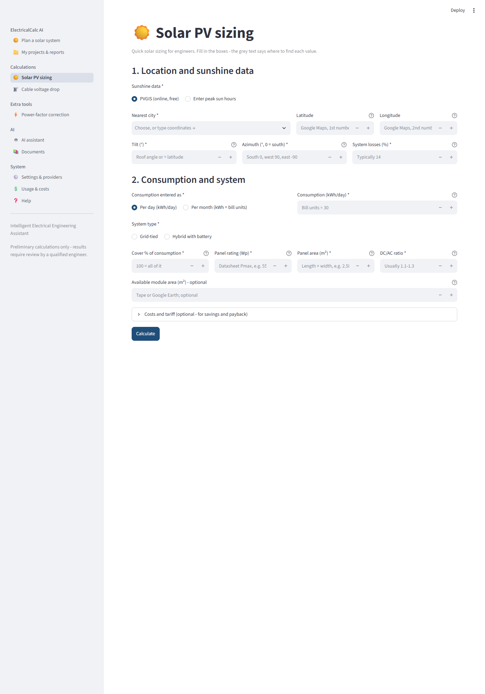

# ElectricalCalc AI

**Preliminary solar PV and electrical calculations with every equation shown**, plus draft engineering reports and an optional AI assistant that *explains* results but never invents the numbers.

> Preliminary design aid only. Outputs are drafts that require review by a qualified engineer. The software never labels a report as certified, approved or stamped.



## Features
- **🏠 Home solar (Nepal)** - method of Boxwell's *Solar Electricity Handbook*, modern data: plain questions (city, roof, NEA bill or appliances, load-shedding hours, meter), panels/inverter/battery/cables, month-by-month **NEA slab bill** with net billing, an interactive **day with a power cut**, and payback/IRR with sliders.
- **🏭 Solar farm (Nepal)** - method of Neill, Stapleton & Martell's *Solar Farms*: P50/P90 energy, row spacing and land in ha/bigha/ropani, 5-step string & inverter matching with cold-morning safety check, loss waterfall, LCOE/IRR vs NEA PPA rates.
- **Plan a solar system (start page), usable by non-engineers:** five plain questions (city, roof, electricity bill or appliances, power cuts, supply type), empty boxes with hints on how to find each value, an appliance picker with typical wattages, and engineer settings with standard values. One click gives a plain-words summary, all calculations (load schedule, PV, inverter, battery, cable voltage drop) and the full PDF report.
- **Solar PV sizing (grid-tied / hybrid):**
  - real yield data from [PVGIS](https://re.jrc.ec.europa.eu/pvg_tools/) (EC JRC), or your own peak-sun-hours value
  - panel count, inverter sizing, and battery sizing that keeps **usable vs nominal** capacity separate
  - savings and payback, monthly table, preliminary bill of materials
- **Power-factor correction:** capacitor bank kvar and µF per phase, with the existing PF taken from kWh/kVArh meter readings or entered directly.
- **Cable voltage drop:** DC / 1-phase / 3-phase, IEC 60228 conductor resistances with temperature correction, and smallest size meeting a drop limit (voltage-drop criterion only; ampacity is deliberately not claimed).
- **Reports:** PDF and editable Markdown with inputs, equations, results, assumptions, warnings, sources and a review record. An optional AI commentary section is kept separate from calculated values.
- **AI assistant (optional):**
  - providers: offline rule-based mode, Ollama (local), Gemini, OpenRouter (free models only), or Anthropic Claude
  - cost controls: monthly budget, per-request cap, usage log, and no silent fallback to a paid provider
- **Document assistant:** local PDF/TXT search with page citations, plus prompt-injection screening.

[Sample installation report (Biratnagar hybrid home)](docs/samples/HOME_installation_report_Biratnagar.pdf)

## Quick start (Windows)
```powershell
git clone https://github.com/kesuj/electricalcalc-app.git
cd electricalcalc-app
uv venv .venv
uv pip install --python .venv\Scripts\python.exe -r requirements.txt
.venv\Scripts\streamlit run app.py
```
macOS/Linux: use `.venv/bin/` instead of `.venv\Scripts\`. Without uv: `python -m venv .venv` then `pip install -r requirements.txt`.

Open http://localhost:8501, answer the questions on **Plan a solar system** and press **Calculate my solar system**.

AI is optional: copy `.env.example` to `.env` and add a key. Paid providers stay blocked until you set `ECALC_MONTHLY_BUDGET_USD`.

## Tests
```powershell
.venv\Scripts\python -m pytest
```
The 211 tests use reference values calculated by hand. See [TESTING.md](TESTING.md).

## Documentation
[ARCHITECTURE](ARCHITECTURE.md) · [ENGINEERING_METHODS](ENGINEERING_METHODS.md) · [SECURITY](SECURITY.md) · [TESTING](TESTING.md) · [CHANGELOG](CHANGELOG.md)

## Author
Built by an Electrical & Electronics Engineering graduate (Kathmandu University, Nepal). Interested in a preliminary sizing report for a real project? Open an issue on this repository.
